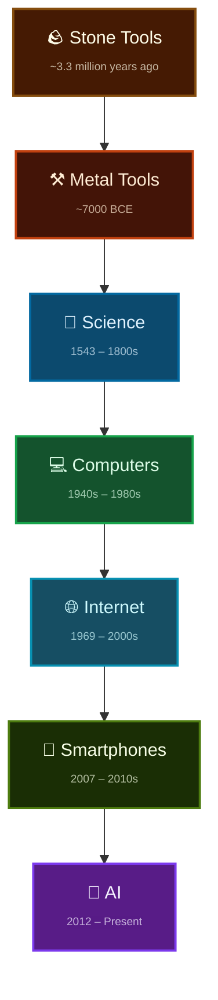
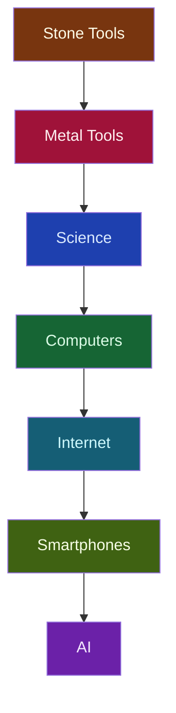

# Technology Evolution

A visual history of humanity's increasing leverage through tools.

## Diagram

## Quick Mermaid Version (clean)

## Summary

| Stage          | Approx. Start     | Key Leap                          | New Capability                     |
|----------------|-------------------|-----------------------------------|------------------------------------|
| Stone Tools    | ~3.3 MYA          | First crafted tools               | Extend physical capability         |
| Metal Tools    | ~7,000 BCE        | Smelting and forging              | Durable, precise, scalable tools   |
| Science        | 1500s–1800s       | Empirical method                  | Systematic discovery & prediction  |
| Computers      | 1940s             | Programmable electronic logic     | Automate calculation & logic       |
| Internet       | 1969 / 1990s      | Global packet-switched network    | Instant global information sharing |
| Smartphones    | 2007              | Pocket-sized always-on computers  | Ubiquitous personal computation    |
| AI             | 2012 →            | Learned models & reasoning        | Automate cognition & creation      |

Each step is a new layer of abstraction that multiplies human leverage.

**Next:** Artificial General Intelligence? Or something entirely different?
